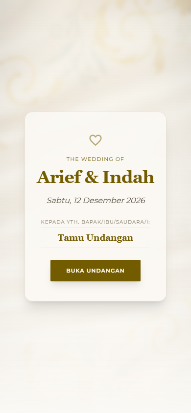
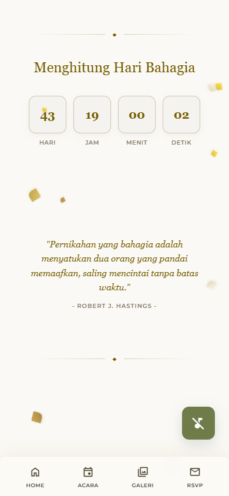

<p align="center">
  
  
</p>

<h1 align="center">Undangan Pernikahan</h1>

<p align="center">
  <strong>A mobile-first digital wedding invitation with a personalized guest name, countdown, RSVP, and guest book.</strong>
</p>

<p align="center">
  <a href="LICENSE"></a>
  
  
  
</p>

A single-page wedding invitation built with HTML, Tailwind CSS, and vanilla
JavaScript. The experience opens with a personalized cover, then reveals a
countdown, a quote, the couple, event details, a gallery, RSVP via WhatsApp, a
guest book, and digital gift details.

## Features

- **Personalized guest name** — read from the `?to=` query parameter, so the
  same link can be sent to every guest: `?to=Budi+dan+Keluarga`.
- **Countdown** — live countdown to the wedding date.
- **Background music** — a play/pause control; music starts when the guest
  opens the invitation.
- **Event details** — dates, venue, and Google Maps links.
- **Gallery** — a responsive photo grid.
- **RSVP via WhatsApp** — the form composes a ready-to-send message.
- **Guest book** — wishes are stored in `localStorage`, with an optional
  Firebase Firestore sync.
- **Digital gifts** — bank account details with copy-to-clipboard.
- **Responsive** — designed for phones first, with a desktop layout.

## Customize

Open `assets/js/app.js` and edit `WEDDING_CONFIG`:

```js
const WEDDING_CONFIG = {
  targetDate: "2026-12-12T08:00:00",
  whatsappNumber: "62812xxxxxxx",
  groomName: "Arief",
  brideName: "Indah",
  gifts: { /* bank accounts */ },
  petalTheme: "gold",
  bgMusicUrl: "...",
  firebase: { enabled: false, config: { /* your project */ } }
};
```

Set `firebase.enabled` to `false` unless you have configured Firestore rules
for the guest book. The default configuration is a demo.

## Run locally

The site is static — any static server works:

```bash
python -m http.server 4173
# http://127.0.0.1:4173
```

Or use the Vite dev server:

```bash
npm install
npm run dev
```

Build:

```bash
npm run build
```

## Personalized links

Generate a link for each guest:

```text
https://your-domain.example/?to=Nama+Tamu
```

`GENERATE_LINK_TAMU.html` is a small helper for creating these links.

## Deploy

Deploy the repository root to Vercel, Netlify, or GitHub Pages. No server is
required.

## License

Released under the [ISC License](LICENSE). The names, photographs, bank account
placeholders, and other personal content are not licensed for reuse.
